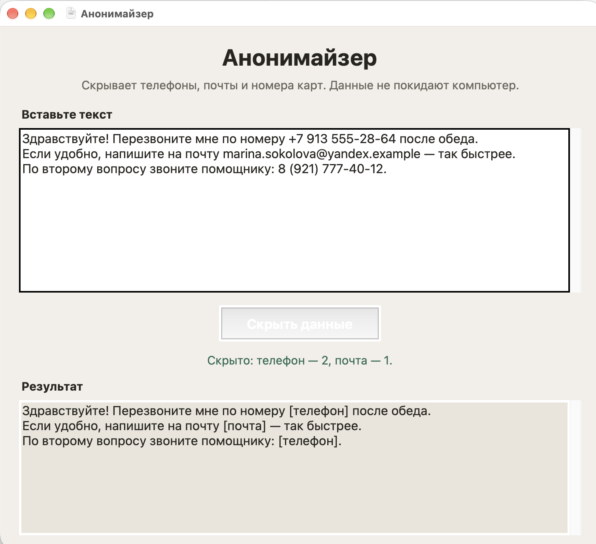
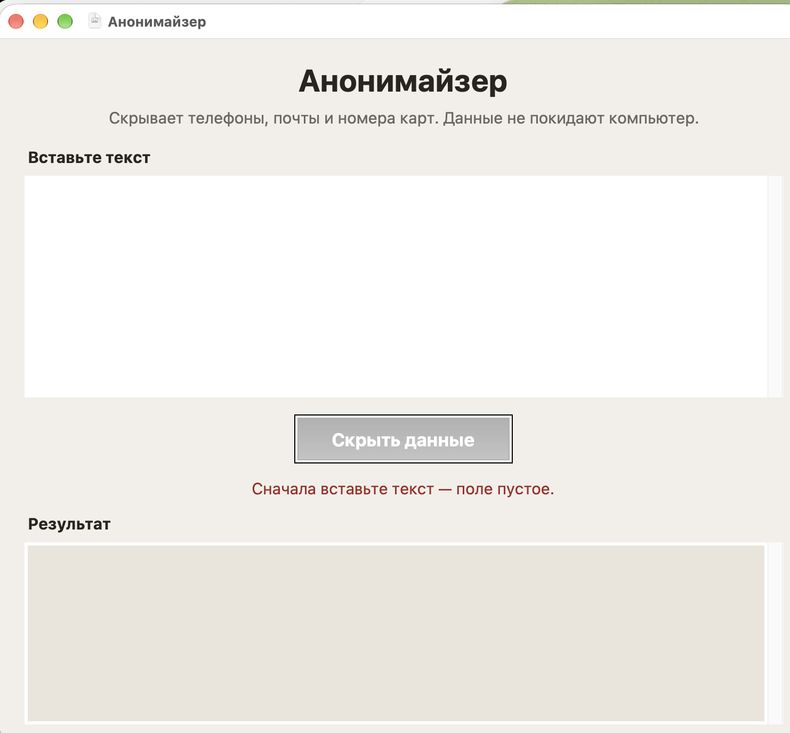

# Анонимайзер — финальный учебный проект

Локальное приложение на Python/Tkinter: заменяет распознанные телефоны, почту и номера карт маркерами и показывает количество замен. Полезно для подготовки вымышленных учебных текстов к демонстрации.

Проект доработан по готовому примеру CDk01 курса Zerocoder и оформлен для CDi01. Мой вклад: воспроизведение поломок, минимальные исправления, проверка сценариев и подготовка документации. Исходное приложение студии «Форма» не выдается за разработку с нуля.

[Публичный репозиторий](https://github.com/elpys-ai/anonymizer-cdi01) · [Скачать исходники ZIP](https://github.com/elpys-ai/anonymizer-cdi01/archive/refs/heads/main.zip)

## Запуск

Нужны Python 3, Tkinter и графическая среда. Проверенная среда: macOS, Python 3.15.2, Tk 9.1. Windows и Linux не проверялись.

1. Скачайте и распакуйте архив либо скопируйте репозиторий.
2. Откройте терминал в папке, где лежит anonymizer.py.
3. Проверьте Tkinter: `python3 -c "import tkinter; print(tkinter.TkVersion)"`.
4. Запустите: `python3 anonymizer.py`.
5. Успешный запуск: открыто окно «Анонимайзер», видны поля ввода/результата и кнопка «Скрыть данные».

Если команда python3 не найдена или импорт tkinter завершается ошибкой, окружение не подготовлено. Установите Python с поддержкой Tkinter для своей ОС; эта инструкция не предполагает автоматической установки. На Windows имя команды может быть python; на Windows запуск не проверялся.

На данном Mac вставка смешанного русского/латинского текста работала при английской раскладке клавиатуры. Если сочетание вставки не действует, переключите раскладку на английскую.

## Проверяемый пример

1. Откройте `primery/pokupatel.txt` как текст и скопируйте его в верхнее поле.
2. Нажмите «Скрыть данные».
3. Внизу оба телефона заменены на [телефон], почта на [почта]; сообщение: «Скрыто: телефон — 2, почта — 1.»
4. Очистите ввод и нажмите кнопку: «Сначала вставьте текст — поле пустое.», результат очищается.
5. Для `primery/kvartira.txt` ожидаются одна карта и один телефон. Остальной текст, включая пробелы после карты, сохраняется.
6. Текст из `primery/bez_dannyh.txt` остаётся неизменным.

Ввод/результат не сохраняются между запусками. При новом запуске рабочие поля пустые.

## Проверки

Из корня проекта: `python3 tests/test_anonymizer.py`.

14 автоматических тестов проверяют примеры, форматы, границы, счётчики, повторную обработку и обработчик кнопки с подставными виджетами. Это не заменяет визуальный прогон окна. Фактические результаты и непройденные проверки: [ACCEPTANCE.md](ACCEPTANCE.md).

## Пример улучшения

Раньше обработчик вызывал `.strip()` для всего текста. Ввод с двумя пробелами до и после строки терял форматирование, хотя приложение сообщало «текст не менялся».

Теперь чтение `source.get('1.0', 'end-1c')` исключает только служебный перевод строки Tk; пустота проверяется отдельно через `if not text.strip()`. Пробелы и переносы пользователя сохранены. Это проверено автоматическими сценариями; исходник и изменённый вариант сравниваются в [патче](evidence/whitespace-improvement.patch).

Дополнительно в CDi01 исправлена читаемость кнопки на macOS: на светлом системном фоне надпись стала тёмной. Новый вид визуально проверен, пример покупателя повторён; [патч](evidence/macos-button-contrast.patch).

## Реальные снимки приложения

Эти снимки сделаны пользователем при проверке предыдущего этапа CDk01. Они демонстрируют существующее окно и обычные сценарии; это не новые снимки финального прогона CDi01 и не доказательство сохранения краевых пробелов.

## Состав

- `PROJECT_BRIEF.md` — паспорт и границы.
- `ACCEPTANCE.md` — фактические проверки.
- `DEMO.md` — сценарий защиты.
- `AGENTS.md` — инструкции работы над проектом.
- `tests/` — автоматические проверки.
- `primery/` — только вымышленные данные.
- `evidence/` — вывод тестов и патч улучшения.

## Ограничения

Шаблоны не гарантируют полноту распознавания личных данных и не проверяют реальную валидность карт. Кириллические почты и полная международная поддержка не реализованы. Производительность на очень больших текстах, узкий экран и отключение сети на уровне ОС не проверялись. Проверьте полученный результат перед реальным использованием. Приложение не отправляет данные в сеть и не ведёт журнал введённого текста; долговременное сохранение не предусмотрено.
